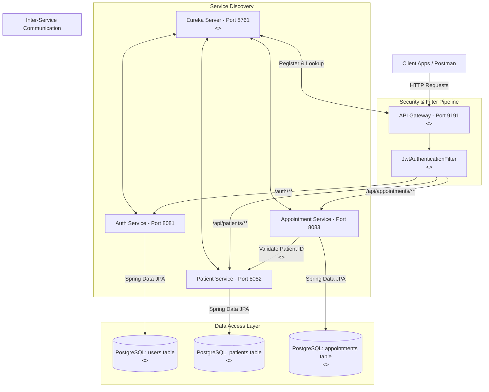

# Pattern Architecture Diagram & System Topology
**System:** Hospital Management System using Spring Cloud Microservices

## Distributed Architecture & Design Pattern Mapping

## Discovered Pattern Highlights
1. **API Gateway & Filter Chain:** `hospital-gateway` serves as single entry point with `JwtAuthenticationFilter`.
2. **Service Discovery:** `EurekaServer` provides dynamic registration and client load balancing.
3. **Repository Pattern:** `PatientRepo`, `AppointmentRepo`, and `UserRepo` abstract database persistence via Spring Data JPA.
4. **Strategy Pattern (Inter-Service Validation):** Interchangeable `RestTemplateConfig` and `WebClientConfig` client execution strategies.
